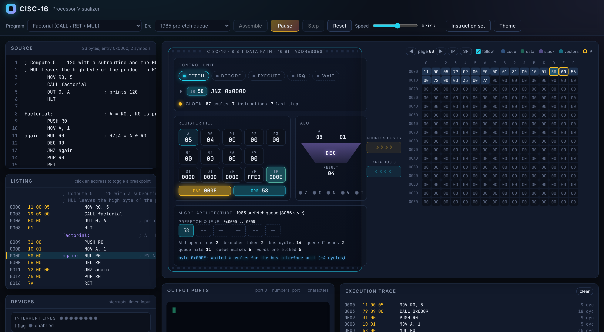

# CISC Processor Simulator 🚀

**Version 0.20 "CISC-16"** - a CISC processor written in C#, modelled on the machines of three decades. The architecture is the kind of 8 bit data path with 16 bit addressing that the Intel 8080 / 8085 and Zilog Z80 made famous, extended with the 8086 ideas that defined CISC in the 1980s (index and base registers, string instructions, stack frames, software interrupts). The *timing* is switchable between three generations of micro-architecture: a 1975 multi-cycle control unit, a 1985 bus interface unit with a prefetch queue, and a 1995 pipeline with caches and a branch predictor. Every program produces the same results on all three; only the clock cycles, and what you see happening inside the chip, change.

The repository contains the core library, a console debugger, an xunit test suite, an animated web visualizer and an ASP.NET Core host that runs the visualizer on the real .NET core.



## What is in the box ℹ️

| Project | What it is |
|---|---|
| `CISCProcessorLibrary/CISCProcessorLibrary` | The processor core: registers, 64 KB memory, ALU, hardware stack, interrupts, port bus with a timer and an input device, the instruction set, the three timing models, assembler, disassembler, micro-operation tracing. No dependencies. |
| `CISCProcessorLibrary/Demo` | Console front end: interactive menu, runs `.asm` files or the built-in samples on any of the three micro-architectures, prints a colored execution trace, micro-operations, registers, timing statistics and a memory dump. |
| `CISCProcessorLibrary/CISCProcessorWeb` | ASP.NET Core host that serves the visualizer and exposes a JSON API so the page runs programs on the .NET core. |
| `CISCProcessorLibrary/CISCProcessorLibrary.Tests` | xunit tests (ALU flags, assembler encodings and errors, processor behaviour, interrupts, string instructions, era timing, sample programs, disassembler round trips). |
| `web/` | The visualizer: a static page with a JavaScript mirror of the processor and its timing models, so it also works offline or from GitHub Pages. |

## The CISC-16 machine 🧠

**Registers**

| Register | Width | Role |
|---|---|---|
| `A` | 8 | Accumulator, the implicit operand of every 8 bit ALU instruction. `MUL` and `DIV` use `R7:A` as a 16 bit value, like `AH:AL` on the 8086. |
| `R0`..`R7` | 8 | General purpose registers. `R6` is the count register of the `REP` string instructions, `R7` the high byte of `MUL` / `DIV`. |
| `SI`, `DI` | 16 | Source and destination index: pointers for the string instructions and for `[SI]`, `[DI+disp]` addressing. |
| `BP` | 16 | Base pointer: the anchor of the current stack frame (`ENTER` / `LEAVE`, `[BP+disp]`). |
| `SP` | 16 | Stack pointer. The stack lives in main memory and grows downwards from `0xFFF0`. |
| `IP` | 16 | Instruction pointer. Programs start at the address of their first instruction. |
| `FLAGS` | 5 bits | `Z` zero, `C` carry / borrow, `N` negative, `V` signed overflow, `I` interrupts enabled. |
| `IR`, `MAR`, `MDR` | 8 / 16 / 8 | Instruction register, memory address register and memory data register: the internal registers that drive the buses. |

**Memory and buses.** 65536 bytes, byte addressable, 16 bit words little-endian. Code, data, the stack and the interrupt vector table share the one address space. `[Rn]` addressing reaches the first 256 bytes only, the zero page of the 6502 and the direct page of the 6809. The vector table sits at `0xFFF0`: eight 16 bit handler addresses, IRQ *n* at `0xFFF0 + 2n`.

**Instruction cycle.** Every instruction goes through *fetch* (opcode into `IR`, `IP` incremented), *decode* (opcode lookup, operand bytes read) and *execute*. Each phase, bus transfer, ALU result, register write, jump decision, interrupt acknowledge, port transfer and timing event (cache hit, queue flush, misprediction) is reported as a **micro-operation**, which is what the trace views and the animation are built from.

**CISC encoding.** One opcode byte followed by zero to three operand bytes. Addressing modes: register, immediate (8 or 16 bit), direct `[addr]`, zero page indirect `[Rn]`, indexed `[addr+Rn]`, register indirect `[SI]` / `[DI]` / `[BP]` / `[SP]`, and based `[BP+disp]` / `[BP-disp]` with a signed 8 bit displacement. Complex instructions do in one step what a RISC machine needs several for: `LOOP`, `REP MOVSB`, `REP SCASB`, `ENTER` / `LEAVE`, `XCHG`, `INC [addr]`, `JMP [SI]`, `MUL` / `DIV`.

**Interrupts.** Eight interrupt request lines. When `I` is set and a line is pending, the control unit acknowledges it between instructions: it pushes `FLAGS` and `IP`, clears `I` and jumps through the vector table; `IRET` pops them back. `INT n` is the software interrupt, the system call of the 1980s. `HLT` with interrupts enabled does not stop the clock: the processor idles until the next interrupt arrives, exactly like the 8080 and the Z80. `HLT` with interrupts disabled halts for good.

**Devices and ports.**

| Port | `OUT port, A` | `IN A, port` |
|---|---|---|
| 0 | print A as a number | next byte of the input queue |
| 1 | print A as a character | next character of the input queue (0 when empty) |
| 2, 3 | timer period, low and high byte, in clock cycles | read back |
| 4 | timer control, bit 0 starts it; the timer raises IRQ 0 every period | 1 when running |
| 5 | | timer tick count |
| 6 | | 1 when input is waiting |
| other | ignored | `0xFF`, the floating bus |

**Faults.** An invalid opcode, a stack overflow or underflow, a division by zero and an 8 bit divide overflow (the 8086 "divide error") stop the processor with a `FaultKind` and a message instead of throwing out of the simulation.

## Three micro-architectures ⏱️

| Era | Model | What costs cycles | What the visualizer shows |
|---|---|---|---|
| **1975** `Classic1975` | Multi-cycle control unit in the spirit of the 8080: every memory byte is a separate machine cycle (4 T-states for the opcode fetch, 3 for every other byte), nothing overlaps. `MOV A, [addr]` costs 4 + 3 + 3 + 3 = 13 T-states, like `LDA` on the 8080. | Bus cycles, internal cycles for INC / DEC / shifts, 16 for MUL, 24 for DIV, 11 for an interrupt acknowledge. | The bus cycles as a row of T-states. |
| **1985** `Prefetch1985` | The 8086 split: a bus interface unit keeps the 16 bit bus busy reading the next instruction words into a 6 byte prefetch queue while the execution unit works. Bytes taken from the queue cost 1 cycle; a byte that is not there yet makes the execution unit wait for the bus. | 4 cycle bus cycles for data and ports, 2 for an ALU operation, 3 for an effective address, 30 for MUL, 40 for DIV, a flush and refill after every taken jump, 40 for an interrupt. | The queue with its bytes and address, hits, misses and flushes. |
| **1995** `Pipelined1995` | A Pentium style five stage pipeline: one simple instruction retires per cycle. Direct-mapped instruction and data caches (16 lines of 16 bytes each) answer in the pipeline; a miss stalls for 8 cycles. A 16 entry branch target buffer with 2 bit saturating counters predicts jumps; a wrong prediction flushes the pipeline for 3 cycles. | 1 cycle per instruction, cache misses, mispredictions, 10 for MUL, 40 for DIV, 8 for an uncached port transfer, 20 for an interrupt. | Both caches line by line, the predictor counters, hits, misses and predictions. |

The same programs, measured by the simulator (clock cycles until `HLT`):

| Program | Instructions | 1975 | 1985 | 1995 |
|---|---|---|---|---|
| Countdown | 17 | 164 | 146 | 71 |
| Fibonacci | 91 | 790 | 636 | 217 |
| Hello, CISC! | 65 | 569 | 490 | 183 |
| Bubble sort | 253 | 2931 | 2276 | 397 |

The numbers are the model's, not a particular chip's, but they move the way history did: the prefetch queue takes the fetch time off the critical path, the pipeline and the caches bring the cost of a simple instruction down to one cycle, and branches become the thing that hurts.

### Assembly language

```asm
; Copy a string with a single REP MOVSB, then print the copy.
; SI = source, DI = destination, R6 = byte count (the CX of this machine).
        MOV SI, source
        MOV DI, buffer
        MOV R6, 14          ; 13 characters plus the terminator
        REP MOVSB           ; the whole copy in one instruction
        MOV SI, buffer
next:   LODSB               ; A = [SI], SI = SI + 1
        CMP A, 0
        JZ done
        OUT 1, A            ; port 1 prints characters
        JMP next
done:   HLT
source: .db "String ops OK", 0
buffer: .ds 14
```

- One statement per line: `[label:] MNEMONIC [operand[, operand]] [; comment]`. Mnemonics, registers and labels are case insensitive.
- Operands: `A`, `R0`..`R7`, `SI`, `DI`, `BP`, `SP`, `FLAGS`, a number or label (immediate or address), `[addr]`, `[Rn]`, `[addr+Rn]`, `[SI]`, `[BP+4]`, `[BP-1]`.
- Numbers: decimal `42`, hex `0x2A` or `$2A`, binary `0b101010`, characters `'A'`, negative values `-1` (stored as two's complement). Labels and numbers can be combined with `+` and `-`, for example `[table+2]`.
- Directives: `.org addr` sets the location counter, `.db v, v, "text"` emits bytes, `.dw word, label` emits little-endian 16 bit words (jump and vector tables), `.ds count` reserves zeroed bytes, `.equ NAME, value` defines a constant.
- The assembler reports errors with the line number and, for a wrong operand combination, lists the valid forms of the mnemonic.

### Instruction set

111 instructions. `imm8` / `imm16` are constants, `addr` a 16 bit address, `Rn` / `Rm` a register `R0`..`R7`, `XR` / `XS` an address register `SI`, `DI`, `BP` or `SP`, `disp8` a signed displacement.

**Control and interrupts**

| Opcode | Syntax | Bytes | Description |
|---|---|---|---|
| `00` | `NOP` | 1 | No operation |
| `01` | `HLT` | 1 | Halt; with interrupts enabled, wait for the next interrupt instead |
| `02` | `EI` | 1 | Enable maskable interrupts (set I) |
| `03` | `DI` | 1 | Disable maskable interrupts (clear I) |
| `04` | `IRET` | 1 | Return from an interrupt handler (pop IP, pop FLAGS) |
| `05` | `INT imm8` | 2 | Software interrupt through vector imm8 (0..7) |

**Data movement**

| Opcode | Syntax | Bytes | Description |
|---|---|---|---|
| `10` | `MOV A, imm8` | 2 | Load an immediate into A |
| `11` | `MOV Rn, imm8` | 3 | Load an immediate into Rn |
| `12` | `MOV A, Rn` | 2 | Copy Rn to A |
| `13` | `MOV Rn, A` | 2 | Copy A to Rn |
| `14` | `MOV Rn, Rm` | 3 | Copy Rm to Rn |
| `15` | `MOV A, [addr]` | 3 | Load A from memory (direct, 16 bit address) |
| `16` | `MOV [addr], A` | 3 | Store A to memory (direct) |
| `17` | `MOV A, [Rn]` | 2 | Load A from zero page address Rn (register indirect) |
| `18` | `MOV [Rn], A` | 2 | Store A to zero page address Rn (register indirect) |
| `19` | `MOV A, [addr+Rn]` | 4 | Load A from addr + Rn (indexed) |
| `1A` | `MOV [addr+Rn], A` | 4 | Store A to addr + Rn (indexed) |
| `1B` | `MOV Rn, [addr]` | 4 | Load Rn from memory (direct) |
| `1C` | `MOV [addr], Rn` | 4 | Store Rn to memory (direct) |
| `1D` | `MOV A, [XR]` | 2 | Load A from the address in SI / DI / BP / SP |
| `1E` | `MOV [XR], A` | 2 | Store A to the address in SI / DI / BP / SP |
| `1F` | `MOV A, [XR+disp8]` | 3 | Load A from XR + signed displacement (based) |
| `20` | `MOV [XR+disp8], A` | 3 | Store A to XR + signed displacement (based) |
| `21` | `XCHG A, Rn` | 2 | Swap A and Rn |
| `22` | `MOV XR, imm16` | 4 | Load a 16 bit immediate into SI / DI / BP / SP |
| `23` | `MOV XR, XS` | 3 | Copy one address register to another |
| `24` | `MOV XR, [addr]` | 4 | Load a 16 bit word (little-endian) into an address register |
| `25` | `MOV [addr], XR` | 4 | Store an address register as a 16 bit word |
| `26` | `LEA XR, [XS+disp8]` | 4 | XR = XS + disp8 (address arithmetic without a memory access) |
| `27` | `MOV Rn, [XR+disp8]` | 4 | Load Rn from XR + signed displacement (based) |
| `28` | `MOV [XR+disp8], Rn` | 4 | Store Rn to XR + signed displacement (based) |
| `29` | `ADD XR, A` | 2 | XR = XR + A (zero extended), for indexing tables |

**Stack and frames**

| Opcode | Syntax | Bytes | Description |
|---|---|---|---|
| `30` | `PUSH A` | 1 | Push A |
| `31` | `PUSH Rn` | 2 | Push Rn |
| `32` | `PUSH FLAGS` | 1 | Push the flags register |
| `33` | `PUSH XR` | 2 | Push an address register (16 bit) |
| `34` | `POP A` | 1 | Pop into A |
| `35` | `POP Rn` | 2 | Pop into Rn |
| `36` | `POP FLAGS` | 1 | Pop into the flags register |
| `37` | `POP XR` | 2 | Pop into an address register (16 bit) |
| `38` | `ENTER imm8` | 2 | Push BP, BP = SP, SP = SP - imm8 (create a stack frame with imm8 bytes of locals) |
| `39` | `LEAVE` | 1 | SP = BP, pop BP (destroy the stack frame built by ENTER) |

**Arithmetic**

| Opcode | Syntax | Bytes | Description |
|---|---|---|---|
| `40` | `ADD A, imm8` | 2 | A = A + imm8 |
| `41` | `ADD A, Rn` | 2 | A = A + Rn |
| `42` | `ADD A, [addr]` | 3 | A = A + [addr] |
| `43` | `ADD A, [XR]` | 2 | A = A + [XR] |
| `44` | `ADC A, imm8` | 2 | A = A + imm8 + C |
| `45` | `ADC A, Rn` | 2 | A = A + Rn + C |
| `46` | `ADC A, [addr]` | 3 | A = A + [addr] + C |
| `47` | `SUB A, imm8` | 2 | A = A - imm8 |
| `48` | `SUB A, Rn` | 2 | A = A - Rn |
| `49` | `SUB A, [addr]` | 3 | A = A - [addr] |
| `4A` | `SUB A, [XR]` | 2 | A = A - [XR] |
| `4B` | `SBB A, imm8` | 2 | A = A - imm8 - C |
| `4C` | `SBB A, Rn` | 2 | A = A - Rn - C |
| `4D` | `SBB A, [addr]` | 3 | A = A - [addr] - C |
| `4E` | `CMP A, imm8` | 2 | Set flags from A - imm8 |
| `4F` | `CMP A, Rn` | 2 | Set flags from A - Rn |
| `50` | `CMP A, [addr]` | 3 | Set flags from A - [addr] |
| `51` | `CMP A, [XR]` | 2 | Set flags from A - [XR] |
| `52` | `INC A` | 1 | A = A + 1 (C unchanged) |
| `53` | `INC Rn` | 2 | Rn = Rn + 1 (C unchanged) |
| `54` | `INC [addr]` | 3 | [addr] = [addr] + 1 (read-modify-write) |
| `55` | `DEC A` | 1 | A = A - 1 (C unchanged) |
| `56` | `DEC Rn` | 2 | Rn = Rn - 1 (C unchanged) |
| `57` | `DEC [addr]` | 3 | [addr] = [addr] - 1 (read-modify-write) |
| `58` | `MUL Rn` | 2 | R7:A = A * Rn (16 bit product, R7 receives the high byte) |
| `59` | `DIV Rn` | 2 | A = R7:A / Rn, R7 = remainder (unsigned); faults on zero or overflow |
| `5A` | `NEG A` | 1 | A = -A (two's complement) |
| `5B` | `ADD XR, imm16` | 4 | XR = XR + imm16 (16 bit) |
| `5C` | `SUB XR, imm16` | 4 | XR = XR - imm16 (16 bit) |
| `5D` | `CMP XR, imm16` | 4 | Set flags from XR - imm16 (16 bit) |
| `5E` | `INC XR` | 2 | XR = XR + 1 (C unchanged) |
| `5F` | `DEC XR` | 2 | XR = XR - 1 (C unchanged) |

**Logic and shifts**

| Opcode | Syntax | Bytes | Description |
|---|---|---|---|
| `60` | `AND A, imm8` | 2 | A = A and imm8 |
| `61` | `AND A, Rn` | 2 | A = A and Rn |
| `62` | `OR A, imm8` | 2 | A = A or imm8 |
| `63` | `OR A, Rn` | 2 | A = A or Rn |
| `64` | `XOR A, imm8` | 2 | A = A xor imm8 |
| `65` | `XOR A, Rn` | 2 | A = A xor Rn |
| `66` | `NOT A` | 1 | A = not A |
| `67` | `SHL A` | 1 | Shift A left, C = old bit 7 |
| `68` | `SHR A` | 1 | Shift A right, C = old bit 0 |
| `69` | `ROL A` | 1 | Rotate A left, C = old bit 7 |
| `6A` | `ROR A` | 1 | Rotate A right, C = old bit 0 |

**Control flow**

| Opcode | Syntax | Bytes | Description |
|---|---|---|---|
| `70` | `JMP addr` | 3 | Jump |
| `71` | `JZ addr` | 3 | Jump if Z = 1 |
| `72` | `JNZ addr` | 3 | Jump if Z = 0 |
| `73` | `JC addr` | 3 | Jump if C = 1 |
| `74` | `JNC addr` | 3 | Jump if C = 0 |
| `75` | `JS addr` | 3 | Jump if N = 1 |
| `76` | `JNS addr` | 3 | Jump if N = 0 |
| `77` | `JO addr` | 3 | Jump if V = 1 |
| `78` | `JNO addr` | 3 | Jump if V = 0 |
| `79` | `CALL addr` | 3 | Push the return address and jump to a subroutine |
| `7A` | `RET` | 1 | Return from a subroutine |
| `7B` | `LOOP Rn, addr` | 4 | Decrement Rn and jump to addr while Rn is not zero |
| `7C` | `JMP [XR]` | 2 | Jump to the word stored at [XR] (jump tables, computed goto) |

**Flags**

| Opcode | Syntax | Bytes | Description |
|---|---|---|---|
| `80` | `CLC` | 1 | Clear the carry flag |
| `81` | `STC` | 1 | Set the carry flag |

**String operations**

| Opcode | Syntax | Bytes | Description |
|---|---|---|---|
| `90` | `LODSB` | 1 | A = [SI], SI = SI + 1 |
| `91` | `STOSB` | 1 | [DI] = A, DI = DI + 1 |
| `92` | `MOVSB` | 1 | [DI] = [SI], SI and DI advance |
| `93` | `CMPSB` | 1 | Set flags from [SI] - [DI], SI and DI advance |
| `94` | `SCASB` | 1 | Set flags from A - [DI], DI advances |
| `95` | `REP MOVSB` | 1 | Copy R6 bytes from [SI] to [DI] |
| `96` | `REP STOSB` | 1 | Fill R6 bytes at [DI] with A |
| `97` | `REP CMPSB` | 1 | Compare up to R6 bytes, stop at the first difference (REPE) |
| `98` | `REP SCASB` | 1 | Scan up to R6 bytes at [DI] for A, stop at the first match (REPNE) |

**Input / output**

| Opcode | Syntax | Bytes | Description |
|---|---|---|---|
| `F0` | `OUT port, A` | 2 | Write A to an output port (0 = decimal, 1 = character, 2..4 = timer) |
| `F1` | `IN A, port` | 2 | Read an input port into A (0 / 1 = input queue, 5 = timer ticks, 6 = input status) |

## Getting started 🛠️

Requirements: [.NET 8 SDK](https://dotnet.microsoft.com/download) (Visual Studio 2022 17.8 or newer, Rider or the command line).

### Console demo

```bash
dotnet run --project CISCProcessorLibrary/Demo
```

The interactive menu runs a sample program, takes a program typed line by line, prints the instruction set reference and switches the micro-architecture. Without the menu:

```bash
dotnet run --project CISCProcessorLibrary/Demo -- --list                              # sample ids
dotnet run --project CISCProcessorLibrary/Demo -- --sample sort --arch 1995 --trace   # run a sample on the 1995 core with a trace
dotnet run --project CISCProcessorLibrary/Demo -- --sample interrupt --micro          # show micro-operations, interrupts, timing events
dotnet run --project CISCProcessorLibrary/Demo -- --sample echo --input "hello"       # feed the input device
dotnet run --project CISCProcessorLibrary/Demo -- program.asm --arch 1985 --delay 200 # run a file, animate the trace
```

`--arch` accepts `1975` / `classic`, `1985` / `prefetch` and `1995` / `pipelined`. The run ends with the registers, the timing model's counters and a dump of every used memory page.

Example of a traced run on the 1995 core:

```
Addr  Bytes       Instruction           | registers after the step (changed = yellow)
0000  10 1E       MOV A, 30             | A=1E R0=00 ... SI=0000 DI=0000 BP=0000 SP=FFF0 IP=0002 -----   9c
        TIMING I-cache miss: instruction cache miss, line 0 filled from memory (+8)
        FETCH  [0000] -> IR = 10
        READ   [0001] -> 1E (operand)
        DECODE 10 = MOV A, 30
        EXEC   MOV
        REG    A 00 -> 1E
0002  30          PUSH A                | A=1E ... SP=FFEF IP=0003 -----   9c
        TIMING I-cache hit: instruction cache hit, line 0 (+0)
        REG    SP FFF0 -> FFEF
        TIMING D-cache miss: data cache miss, line 14 filled from memory (+8)
        WRITE  [FFEF] <- 1E (stack)
```

### Web visualizer 🖥️

Two ways to open it:

1. **Served by .NET** (programs run on the C# core through the API):

   ```bash
   dotnet run --project CISCProcessorLibrary/CISCProcessorWeb
   ```

   then open <http://localhost:5080>. The page detects the server and shows an *Engine* selector (`.NET server` / `JavaScript (browser)`). While running from the source tree the host serves the repository's `web/` folder directly.

2. **Static**: open `web/index.html` in a browser, or publish the `web/` folder anywhere. The page then runs on its JavaScript mirror of the processor and of the three timing models, which produce the same traces and cycle counts as the C# library.

3. **GitHub Pages**: the workflow in `.github/workflows/pages.yml` publishes `web/` on every push to `master` that touches it. Enable it once under *Settings -> Pages -> Source: GitHub Actions*; the site then appears at `https://<user>.github.io/<repository>/`. Pages hosts static files only, so the *Engine* selector does not appear there and programs run on the JavaScript engine.

What the page shows:

- **Source, listing and devices**: an editor with line numbers and error markers, the assembler listing (click an address to toggle a **breakpoint**), the eight interrupt lines, the timer and the input device with a text box for `IN A, 1`.
- **The die**: control unit with the fetch / decode / execute phases plus the interrupt and wait states, the decoded instruction, the clock, the register file with the 16 bit address registers, `MAR` / `MDR`, an ALU that lights up with its operands and result, the flag LEDs, and a **micro-architecture block** that changes with the era: T-states in 1975, the prefetch queue in 1985, both caches and the branch predictor in 1995.
- **Buses and memory**: packets travel over the 16 bit address bus and the 8 bit data bus between the processor and a 256 byte window of memory. The window follows every access by default (code at the bottom, the stack and the vector table at the top of the address space) and can be paged by hand. Code, data, the stack, the vector table and the current instruction are color coded; reads and writes flash.
- **Output ports and execution trace**, including interrupt acknowledges and idle steps, plus a status bar with the processor state, `IP`, `SP`, the phase, the era and the engine.
- Controls: *Program*, *Era*, *Assemble* (Ctrl+Enter), *Run / Pause* (F5), *Step* (F8), *Reset*, a speed slider from a slow crawl to a turbo mode without animation, the instruction set reference and a light / dark theme. `?program=sort&era=Pipelined1995` in the URL preselects a sample and an era.

### Web API

The host exposes the processor as JSON (paths relative to the site root):

| Method and path | Purpose |
|---|---|
| `GET /api/info` | Engine name, version, runtime, instruction count, the three micro-architectures. |
| `GET /api/instructions`, `GET /api/samples`, `GET /api/microarchitectures` | The opcode table, the sample programs, the era descriptions. |
| `POST /api/assemble` `{ "source": "..." }` | Assembles and returns the listing and symbols, or a `400` with the line and message. |
| `POST /api/sessions` `{ "source", "microarchitecture", "input" }` | Assembles, creates a processor session on the given era and returns its id, program, state and timing snapshot. |
| `POST /api/sessions/{id}/step` | Performs one step (an instruction, an interrupt acknowledge or an idle quantum) and returns its trace. |
| `POST /api/sessions/{id}/run` `{ "maxSteps": 512, "stopAt": [addresses] }` | Performs up to N steps, stopping in front of breakpoint addresses. |
| `POST /api/sessions/{id}/input` `{ "text": "..." }` | Queues text into the input device. |
| `POST /api/sessions/{id}/reset` | Reloads the program and refills the input queue. |
| `DELETE /api/sessions/{id}` | Drops the session. Idle sessions are removed after 30 minutes. |

### Using the library

```csharp
using CISCProcessorLibrary;
using CISCProcessorLibrary.Timing;

var cpu = new CISCProcessor(Microarchitecture.Pipelined1995);
cpu.OutputWritten += (_, e) => Console.Write(e.Text + " ");
cpu.InstructionExecuted += (_, step) => Console.Error.WriteLine(step);   // "0003  12 00   MOV A, R0   1 cycles"

cpu.LoadProgram(SamplePrograms.Interrupt.Source);                         // assembles and loads
RunResult result = cpu.Run();                                             // until HLT, a fault or the step budget

Console.WriteLine($"{result.Reason}: {result.InstructionsExecuted} instructions, {result.Cycles} cycles");
foreach ((string counter, long value) in cpu.Timing.Statistics)
    Console.WriteLine($"{counter}: {value}");                             // I-cache hits, mispredictions ...
```

`Assembler.Assemble(source)` returns an `AssembledProgram` with the listing and symbol table, `Disassembler.Disassemble(memory, address)` turns bytes back into text, `cpu.Step()` runs one step and returns a `StepTrace` with every `MicroOp`, `cpu.RequestInterrupt(irq)` raises a line from outside, `cpu.InputDevice.Enqueue(text)` feeds the input port, `cpu.Microarchitecture` switches the timing model, and `InstructionSet.Default` describes all opcodes.

### Tests

```bash
dotnet test CISCProcessorLibrary
```

## Sample programs 📚

| Id | Name | Shows |
|---|---|---|
| `countdown` | Countdown | `LOOP` and the numeric output port |
| `sum` | Sum of an array | indexed addressing `[data+R1]` over a `.db` table |
| `fibonacci` | Fibonacci | the carry flag stopping a loop at the 8 bit limit |
| `factorial` | Factorial | `CALL` / `RET`, `PUSH` / `POP` and the 16 bit `MUL` |
| `hello` | Hello, CISC! | `LODSB` walking a string, the character port |
| `stack` | Stack and subroutines | swapping registers through the stack, `SHL` in a subroutine |
| `sort` | Bubble sort | nested `LOOP`s and indexed stores; the best program to compare the three eras on |
| `strings` | String instructions | `REP MOVSB` copying a string in one instruction |
| `scan` | Fill and scan | `REP STOSB` and `REP SCASB` |
| `frames` | Stack frames | `ENTER` / `LEAVE`, arguments and locals through `[BP+disp]` |
| `jumptable` | Jump table | `JMP [SI]` through a `.dw` table |
| `interrupt` | Timer interrupt | the timer on IRQ 0, `EI`, `HLT` waiting for an interrupt, `IRET`, the vector table |
| `echo` | Input echo | `IN A, 6` / `IN A, 1` reading the input device |
| `fault` | Hardware fault | `DIV` by zero halting the processor with a fault |

## Repository layout 📁

```
CISCProcessorLibrary/
  CISCProcessorLibrary.sln
  CISCProcessorLibrary/        core library (CISCProcessor, ArithmeticLogicUnit, Memory, InstructionSet,
                               Instructions/, Timing/, Devices/, Assembler, Disassembler, SamplePrograms ...)
  Demo/                        console front end
  CISCProcessorWeb/            ASP.NET Core host + JSON API (serves web/ while developing, wwwroot when published)
  CISCProcessorLibrary.Tests/  xunit tests
web/
  index.html, css/style.css    the visualizer page
  js/isa.js, timing.js,        JavaScript mirror of the instruction set, the timing models,
  js/cpu.js, assembler.js,     the processor and the assembler
  js/samples.js                the sample programs (generated from SamplePrograms.cs)
  js/app.js                    user interface and animation player
docs/visualizer.png            screenshot
```

## Changelog 📝

- **0_015** - GitHub Pages workflow for the visualizer.
- **0_014** - README for version 0.20.
- **0_013** - Visualizer for CISC-16: era selector with the micro-architecture block (T-states, prefetch queue, caches and branch predictor), 16 bit registers, paged 64 KB memory window, devices panel with interrupt lines, timer and input device, interrupt and wait steps in the trace; web host API with micro-architecture selection and input; JavaScript mirror of the timing models.
- **0_012** - CISC-16 core: 64 KB address space with 16 bit `IP`, `SP`, `BP`, `SI`, `DI`, register indirect and based addressing, 16 bit immediates and `.dw`, the `I` flag with eight interrupt lines, a vector table, `EI` / `DI` / `INT` / `IRET` and `HLT` that waits for an interrupt, a port bus with a programmable timer and an input device (`IN`), string instructions with `REP`, `ENTER` / `LEAVE`, `JMP [XR]`, `LEA`, 16 bit `MUL` / `DIV` with the divide overflow fault, and the three timing models (1975 multi-cycle, 1985 prefetch queue, 1995 pipeline with caches and branch prediction) reporting their events into the trace. Demo with `--arch` and `--input`, 329 tests.
- **0_011** - Web host: static web assets disabled and the web root resolved at start-up, so `dotnet run` works from the source tree.
- **0_010** - README for version 0.10.
- **0_009** - Web visualizer (`web/`) with animated buses, ALU, registers, memory map, breakpoints and samples; `CISCProcessorWeb` ASP.NET Core host and JSON API; JavaScript mirror of the core.
- **0_008** - CISC-8 core: 8 bit registers and 256 bytes of memory, hardware stack, Z C N V flags, fetch - decode - execute cycle with micro-operation tracing, two pass assembler, disassembler, faults, sample programs, console demo and test suite.
- **0_007** - Stack processor and colored console output.
- **0_001** - **0_006** - Initial implementation and README.

## License

MIT, see `LICENSE.txt`.
